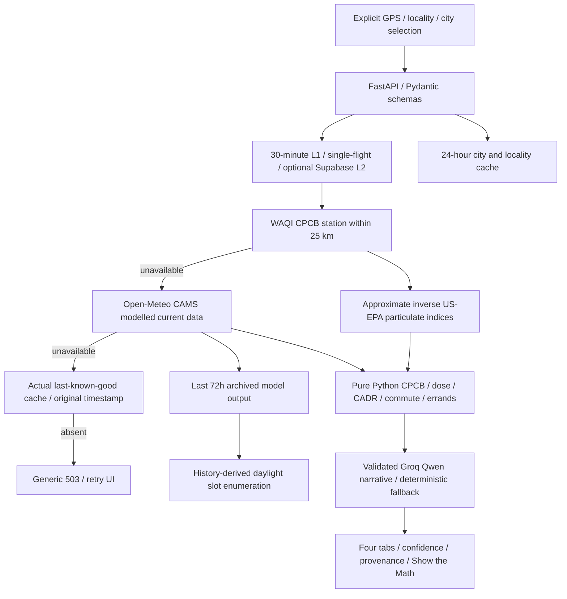

# Urbero — Urban Air Quality Assistant

Location-first air quality guidance for Indian households. Four workspace tabs retain household profiles, routine/commute comparisons, indoor CADR guidance, and copy-ready family/community briefings. No login or judge-supplied API keys.

[](docs/audit-verification.md)

## Setup and verification

Use Python 3.12+ and a Vitest-supported Node release: 22.12+, 24, or 26+ (CI uses Python 3.12 and Node 22).

```sh
python -m pip install -e ".[dev]"
npm --prefix frontend ci
# Optional deployment credentials; do not commit .env
# Copy .env.example to .env, fill in the services you enable, and add --env-file .env.
python -m uvicorn backend.app.api.routes:app --reload --port 8000 --no-access-log
# In another terminal
npm --prefix frontend run dev
```

Open http://localhost:5173 and choose a location. Then optionally apply a household preset to load an example schedule for that location. In Routine & Commute, edit activities by local start and end time or ask for travel advice. Metro appears in known operating areas. WAQI requires an operator-owned `WAQI_API_TOKEN`. The app uses labelled CAMS model estimates when a current station reading is unavailable. Configure Groq with `GROQ_API_KEY` and `GROQ_MODEL` to generate Qwen briefings and travel suggestions. Deployments with an existing `gsk_` key stored under `GROK_API_KEY` can continue using `GROK_MODEL` during migration to the Groq variables. Deterministic templates cover disabled or failed generation.

Run all seven requested gates with `python scripts/verify.py` (or `make verify`). Complete output is saved to [docs/audit-verification.md](docs/audit-verification.md). Python tools use module invocation because executable launchers fail with DLL relocation errors on this Windows installation.

```sh
# From backend/
python -m ruff check .
python -m mypy --strict app
python -m pytest --cov=app --cov-report=term-missing
# From frontend/
npm run typecheck
npm run lint
npm test
npm run build
```

Coverage below 90% fails verification. The test suite replays recorded CAMS data, WAQI protocol cases and Groq responses without provider credentials. The pure AQI and exposure engines have import-isolation, boundary and Hypothesis tests. CI checks the landing page at Lighthouse accessibility ≥95 and tests the location gate, preset selection and keyboard tab navigation in Chromium at 390 px and 1440 px. Vitest runs `jest-axe` against the landing page, location gate and all four tabs in both themes. See [the browser gate](.github/workflows/ci.yml) for the pinned Playwright and Lighthouse commands.

Regenerate the single-source API types with `npm --prefix frontend run generate:api`. Never hand-edit `frontend/src/api/generated.ts`.

## Architecture and data honesty



[ADR 0002](docs/adr/0002-waqi-cams-location-first.md) supersedes the original OpenAQ scope. No OpenAQ adapter, credentials or fixtures remain in application code.

- WAQI `iaqi` is an index, not concentration. PM2.5/PM10 are approximately inverted using WAQI's published 2012 US-EPA scale, then passed to CPCB breakpoints. Original index, formula and limitations appear in card math. Gas indices are not treated as concentrations. Fewer than three valid pollutants means **no valid overall CPCB AQI**; available particulate sub-indices remain visible. Reconstructed/hourly values are not certified CPCB 24-hour/8-hour averages.
- CAMS fallback uses `status="modelled_live"`, `source="Open-Meteo CAMS (Modelled)"`, and Low confidence. Grid-cell distance is not station proximity. `past_days=3` is archived **model output, not empirical station history**. Future hours are excluded from the optimizer; missing history disables timing optimization. CO µg/m³ is divided by 1000 before CPCB calculations.
- Both providers failing may serve actual cached data as `stale`, preserving original `observed_at` and source. No data and no cache returns 503. Missing values are never replaced with zero, fabricated AQI, or a synthetic smog curve.
- WAQI hardware grade is unknown unless independently verified. Haversine distance uses exact request coordinates while cache/network lookup uses a two-decimal grid. Application logs exclude raw GPS and provider URLs/tokens.
- Breathing rates, indoor infiltration, travel speeds, mode exposure factors and transport emissions are illustrative scenario assumptions in `config/constants.py`, not personalized health predictions. Metro/EV factors include grid emissions; zero tailpipe emissions do not mean zero lifecycle emissions. Errand inter-stop distances use an explicitly approximate clustered-distance model, not navigation routing. All stop windows must be feasible.
- Cigarette equivalence is a Berkeley Earth communication heuristic, not a clinical equivalent. WHO 15 µg/m³ and NAAQS 60 µg/m³ are reference values, never personal safe budgets. Plants are a low-impact footnote after source control, sealing, ventilation and filtration. Very Poor/Severe particulate conditions include fitted N95/FFP2, cloth-mask limitations and a doctor advisory.
- The optional room-photo endpoint validates/re-encodes images in memory. Without a supported vision client it returns an unavailable-analysis result, never invented room detection or dimensions; manual measurements remain required.

## Requirement → file → test

| Requirement | Implementation | Verification |
|---|---|---|
| WAQI PM inversion, freshness, CPCB attribution, station radius | `providers/waqi.py`, `providers/base.py` | `test_waqi.py` |
| CAMS current/history/forecast, units, missing/absurd values | `providers/openmeteo.py` | `test_openmeteo.py` |
| WAQI → CAMS → actual stale cache, retries and coalescing | `providers/pipeline.py`, `providers/cache.py`, `providers/resilience.py` | `test_pipeline.py`, `test_cache.py`, `test_resilience.py` |
| CPCB boundaries and minimum pollutant rule | `aqi/cpcb.py` | `test_cpcb.py`, `test_integrity.py`, `test_hypothesis_properties.py` |
| Confidence and model limitations | `aqi/confidence.py`, `common/ConfidenceBadge.tsx` | `test_confidence.py`, `test_api_failures.py`, `RecommendationCards.test.tsx` |
| History-derived diurnal slots, routine, smog/clean days | `aqi/diurnal.py`, `exposure/optimizer.py` | `test_diurnal.py`, `test_optimizer.py` |
| Inhaled dose and activity monotonicity | `exposure/dose.py` | `test_dose.py`, `test_integrity.py`, `test_hypothesis_properties.py` |
| CADR applied dimensions, source adjustment, retry and plants footnote | `exposure/cadr.py`, `IndoorAirGuide/`, `App.tsx` | `test_cadr.py`, `IndoorAirGuide.test.tsx`, `App.test.tsx` |
| Manual errand stops, fixed-window feasibility, applied emissions and dose change | `exposure/errands.py`, `LowEmissionRoutine/ErrandEditor.tsx`, `LowEmissionRoutine/ErrandLoop.tsx` | `test_errands.py`, `test_integrity.py`, `test_api_routes.py`, `App.test.tsx` |
| Planet vs. Lungs comparisons | `exposure/commute.py`, `LowEmissionRoutine/` | `test_commute.py`, `LowEmissionRoutine.test.tsx` |
| Structured Groq Qwen JSON, retry, fallback briefings and travel advice | `planner/grok.py`, `planner/fallback.py` | `test_planner.py`, `test_api_failures.py` |
| API response contracts, daily-plan assembly, size limits, CSP and privacy-safe throttling | `planner/schemas.py`, `api/routes.py`, `api/daily_plan.py`, `api/security.py` | `test_api_routes.py`, `test_api_failures.py`, `test_browser_security.py` |
| Location gate, GPS/search/chips, unselected presets | `App.tsx`, `components/LocationPicker.tsx`, `HouseholdProfile/`, `providers/geocoding.py` | `App.test.tsx`, `LocationPicker.test.tsx`, `HouseholdProfile.test.tsx`, `test_geocoding.py` |
| Four tabs, keyboard focus, chart/table alternatives, light and dark accessibility | `components/DashboardShell.tsx`, `LowEmissionRoutine/`, `scripts/check-ui.mjs` | `DashboardShell.test.tsx`, `LowEmissionRoutine.test.tsx`, `App.test.tsx`, Playwright and Lighthouse |
| Card provenance and expandable actual math | `common/RecommendationCards.tsx`, `common/MathDrawer.tsx`, `ImpactJustification/` | `RecommendationCards.test.tsx`, `ImpactJustification.test.tsx` |
| Room-photo validation / EXIF removal / unavailable analysis | `planner/vision.py` | `test_vision.py`, `test_api_routes.py` |
| Pure engines, no external I/O imports | `aqi/`, `exposure/` | `test_pure_imports.py` |
| Challenge source alignment (pending) | The brief requires OpenAQ v3 observations and same-station history with xAI Grok at the narrative edge. The deployed configuration uses WAQI, labelled archived CAMS model output and Groq with Qwen. | OpenAQ replay and operator-credential failover checks belong to the provider alignment phase. See [ADR 0002](docs/adr/0002-waqi-cams-location-first.md). |

Backend paths above are relative to `backend/app/`; frontend component paths are relative to `frontend/src/`.

## Sources and deployment limits

- [WAQI API contract, attribution and usage terms](https://aqicn.org/api/); [published PM scale](https://aqicn.org/faq/2013-09-09/revised-pm25-aqi-breakpoints/).
- [Open-Meteo air quality contract](https://open-meteo.com/en/docs/air-quality-api), including CAMS attribution, units and archived model output. Check the applicable free/non-commercial or paid-service terms before deployment.
- [CPCB National AQI](https://cpcb.nic.in/National-Air-Quality-Index/); [WHO 2021 guidelines](https://www.who.int/publications/i/item/9789240034228); [Berkeley Earth heuristic](https://berkeleyearth.org/air-pollution-and-cigarette-equivalence/).
- [India NAAQS PM₂.₅ reference](https://cpcb.nic.in/upload/NAAQS_2019.pdf), [NASA chamber study on plants and indoor VOCs](https://ntrs.nasa.gov/citations/19930072988).

`VERIFY_BEFORE_PROD`: validate the deployment WAQI token and confirm its feed scale/version, averaging metadata and caching permissions; calibrate scenario assumptions. A provider index cannot recover missing raw precision or certify regulatory averaging. No claim of live WAQI credential validation or full WCAG certification follows from fixture/axe tests.

Cloud Run configuration uses `min-instances=1`, server-side secrets, and a non-root container. FastAPI serves the built frontend. For optional shared caching, provision `public.station_cache(cache_key text primary key, payload jsonb not null)` with access restricted to the server service role. It stores provider readings, CAMS model data, and public city/locality results. Shared search keys are keyed hashes, and reverse lookups use a two-decimal grid. Briefings use the current facts for each request.
